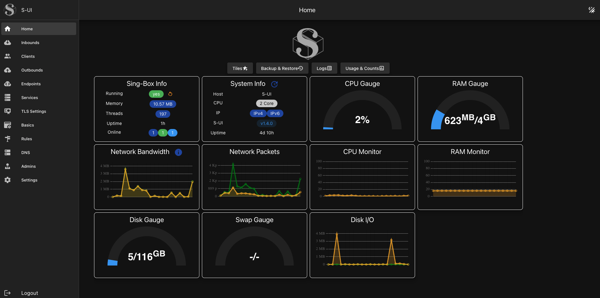
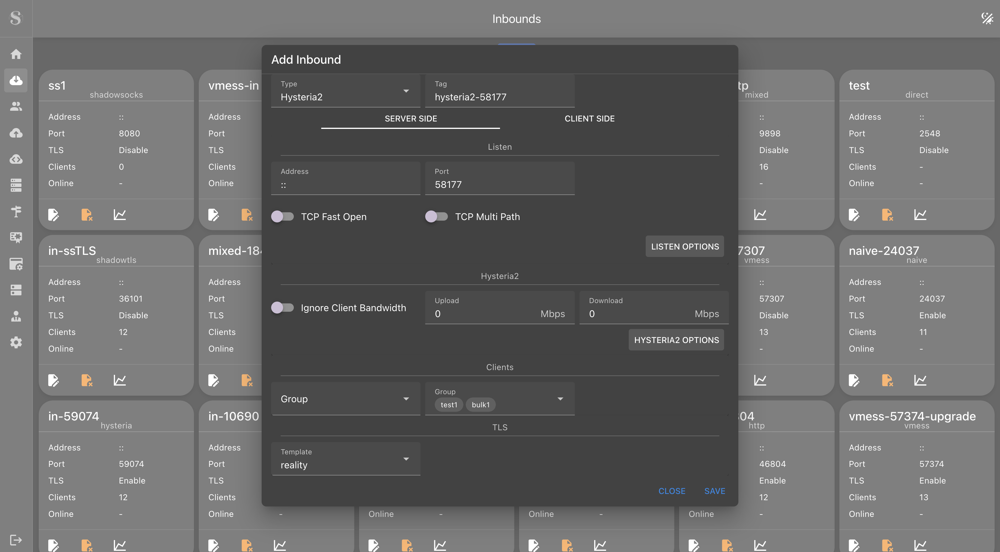
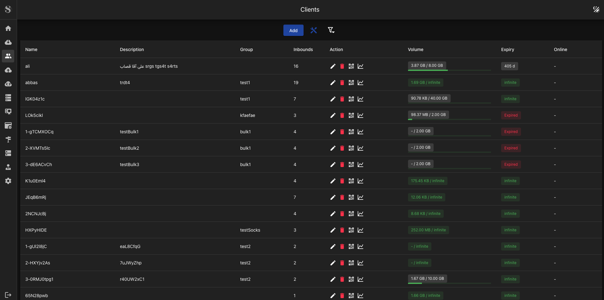
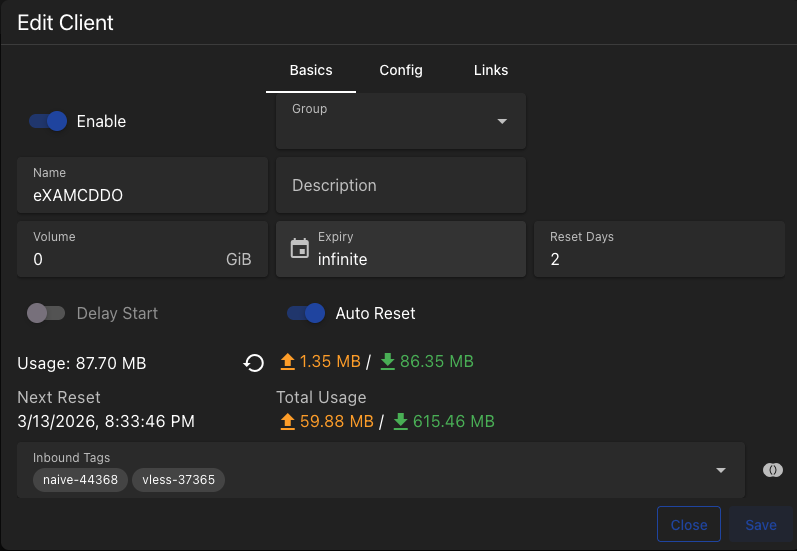
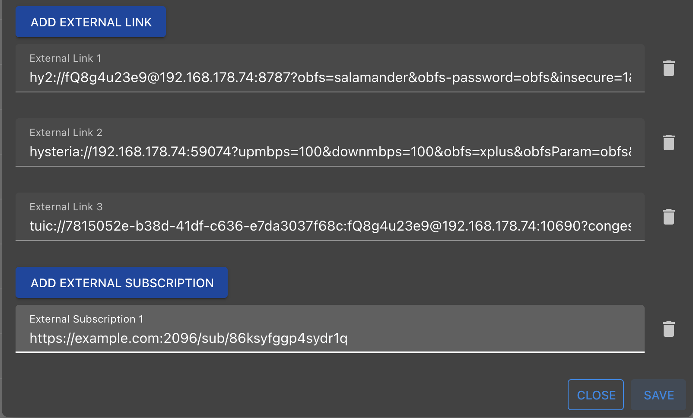
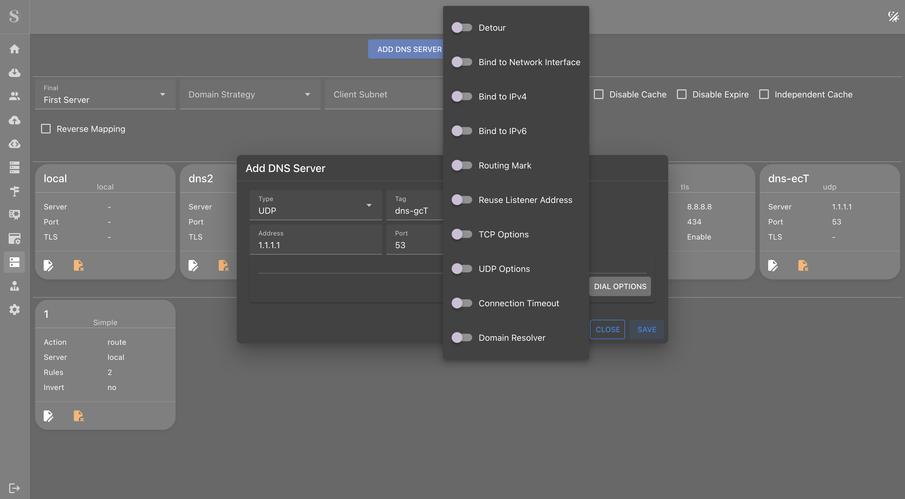
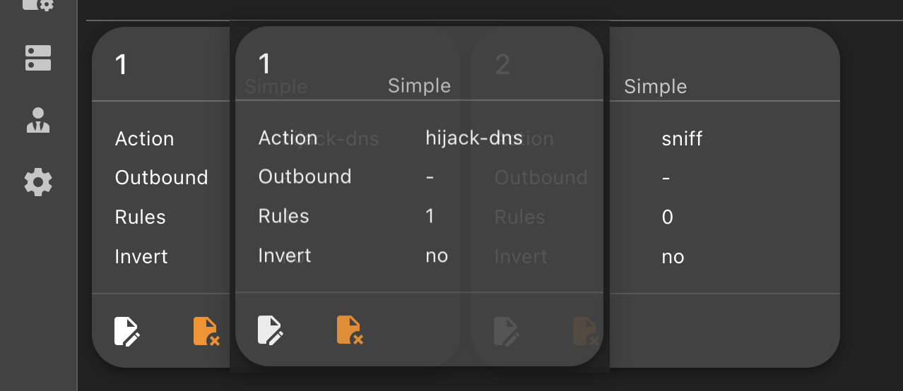
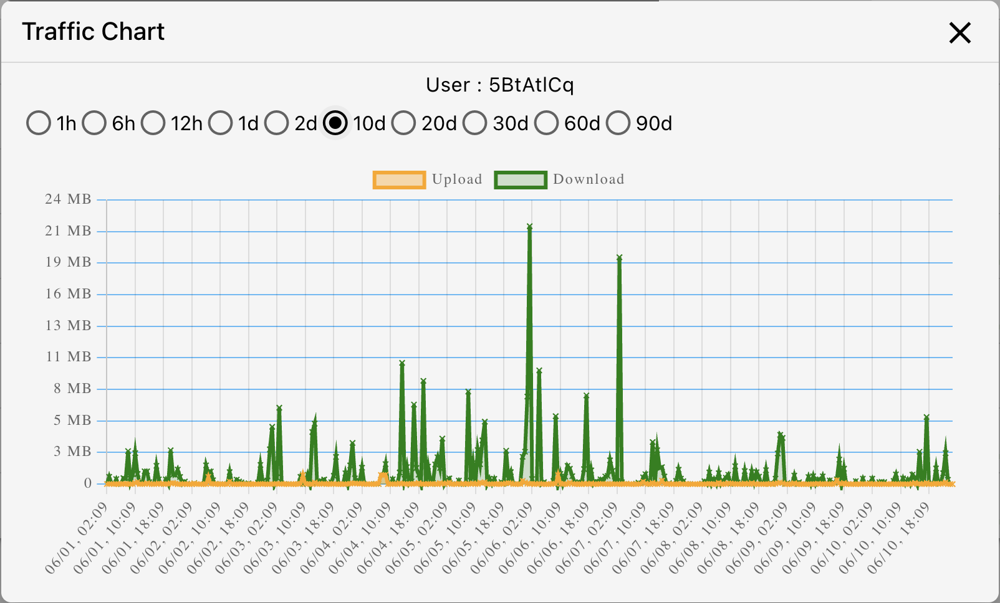

## 历史界面截图 / Historical screenshots

以下图片保留自上游旧版，仅用于展示功能，不代表当前版本的界面、默认端口、协议兼容性或安全设置。图片中的地址和凭据仅为示例，不要直接用于部署；TLS/Reality 等配置请以根目录 README 和协议说明为准。历史图片保留，不作为新安装包已更新的证据。

These are historical upstream UI examples, not the current release or recommended deployment settings. Do not reuse the example credentials or insecure TLS settings.

### Main

### Inbounds

### Clients

### Edit Client

### External Links

### DNS

### Drag and Drop Rules

### Traffic Chart

